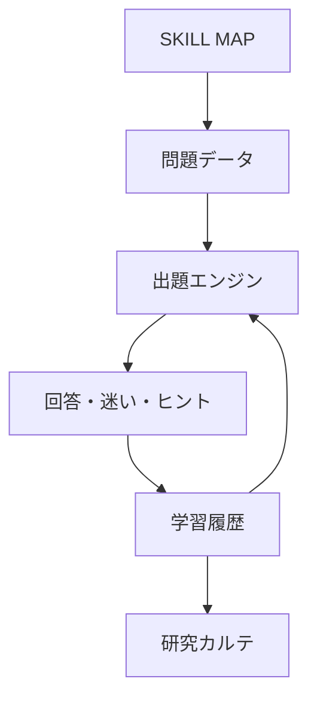

# ことラボ 教育・システム設計 v1.1

## 固定する骨格

| LAB | 最小単位 | 中心となる問い |
|---|---|---|
| ことば | 語・表現 | どのことばがぴったり？ |
| 文づくり | 一文 | どうすれば伝わる文になる？ |
| つながり | 文と文 | どんな関係でつながっている？ |
| 文章 | 文章 | どう組み立てれば伝わる？ |

新しい教材を増やすときもLABを増設せず、4LAB内のSKILLまたはSUBSKILLとして追加する。

## 二つの軸

- `contentLevel`：扱う言語内容の難しさ（1〜6）
- `depth`：気づく → 分ける → 選ぶ → 直す → 使う → 転移する（D1〜D6）

学年、内容の難しさ、習熟の深さを同一視しない。

## データの流れ

文例は `questions.js`、能力体系は `skill-map.js`、判定は `engine.js` に分ける。問題追加のために画面コードを変更しない。

## 学年段階をまたぐ語彙の系統

既存の4LABを保ったまま、次の6領域をSKILLとして追加する。

| 主な段階 | 独自SKILL | 学習の焦点 |
|---|---|---|
| 低学年から | ことばの仲間 | 身近な語を意味で集め、場面に合う語を選ぶ |
| 中学年から | 気持ちと人がら | 様子・行動・心情を根拠と結び付ける |
| 中学年から | 昔から伝わる言葉 | 慣用的な表現を文脈の中で理解する |
| 高学年へ | ことばの組み立て | 接頭語・接尾語・複合語から意味を考える |
| 全学年で発展 | 学習に使う言葉 | 比較・要点・根拠など、思考を支える語を使う |
| 高学年へ | 場面に合う言い方 | 相手・目的・関係に応じて敬意や丁寧さを選ぶ |

72問を独立した一覧として暗記させるのではなく、既存エンジンの「選ぶ・考え直す・別場面へ転移する」に載せる。回答履歴から、実際に出会った言葉だけを「ことばファイル」に表示する。

## ナビと達成の設計

- ナビキャラクターはファンタジー設定を持たせず、開始・ヒント・再挑戦・完了の状態を短く補助する。
- 問題画面では小さく表示し、問題文と選択肢より目立たせない。
- 42個のバッジは正答数だけでなく、初挑戦、ヒント利用、考え直し、復習、継続、転移、各SKILL・LABの成長を評価する。
- 未獲得バッジの細かな条件は隠し、一度に大量のロック条件を見せない。

## 教材参照と独自性

学習指導要領や教材会社の公開資料は、扱う領域と発達段階を確認する参考資料として使う。市販教科書・付録教材の語句選定、分類名、配列、例文、解説、紙面表現は収録しない。問題、6分類、語義、用例、フィードバックはことラボ独自に作成し、教材固有の名称も画面に使用しない。

## 現段階の境界

MVPは機械判定できる選択問題を中心にする。自由記述は採点せず「ためしてみよう」として出口に置く。履歴は個人情報を持たず、その端末のブラウザ内にだけ保存する。
