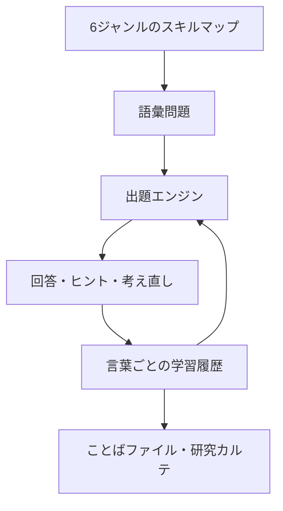

# ことラボ 教育・システム設計 v2.1

## 目的

ことラボは、小学1〜6年生の語彙を増やし、意味の違いを理解し、文脈に合わせて言葉を使い分けられるようにするアプリです。

文法事項、接続詞、敬語、主語・述語、文と文の関係、文章構成は扱いません。ことわざ・慣用句・故事成語は専用アプリ「ことばのしるべ」に分けます。

## 6つのジャンル

| ID | ジャンル | 中心となる問い |
|---|---|---|
| meaning | ことばの意味・仲間 | この言葉はどんな意味で、何の仲間？ |
| precise | ぴったりのことば | 似た言葉の中で、どれが場面に合う？ |
| feelings | 気持ち・人がら | どんな心情や人がらを表している？ |
| sensory | 動き・様子・感覚 | 動きや感覚を、もっと細かく表すには？ |
| learning | 学習・思考のことば | 調べたり考えたりするとき、どんな言葉を使う？ |
| structure | ことばの成り立ち・熟語の構成 | 漢字や言葉は、どのように組み合わさっている？ |

## 語彙を身につける学習サイクル

- 出会う：新しい言葉を問題や文脈の中で知る
- 意味を知る：言葉が表す内容を捉える
- 比べる：類義語・対義語・近い表現との違いを考える
- 選ぶ：文脈や目的に合う言葉を選ぶ
- 使う：別の場面でも意味を生かせるか確かめる

正答数だけを語彙力とみなさず、言葉ごとの学習段階を記録します。

## 二つの難しさの軸

- `contentLevel`：扱う語彙・表現の難しさ（1〜6）
- `depth`：出会う → 意味を知る → 比べて選ぶ → 使い分ける → 使う → 別の場面へ（D1〜D6）

学校の学年、チャレンジレベル、言葉自体の難しさ、学習の深さは同一視しません。

## データの流れ

- ジャンルとスキル：`skill-map.js`
- 問題文・選択肢：`question-sets/`
- 統合・語彙カード生成：`questions.js`
- 出題と習熟判定：`core/engine.js`
- 画面表示：`app.js`
- 保存：`core/storage.js`

## ことばファイル

問題で実際に出会った語句だけを記録します。問題バンクにある全語句を最初から一覧表示しません。

語句の記録段階は次の通りです。

1. 出会った
2. 意味が分かる
3. 使い分けられる
4. 別の場面でも使える

同じ語句が複数の問題に登場する場合は一つのカードにまとめ、関連する問題IDをひも付けます。

## 熟語の構成

「ことばの成り立ち」には、接頭語・接尾語・複合語に加え、二字熟語の構成を含めます。扱う関係は、似た意味、反対の意味、上の字が下の字を修飾、目的・対象、主語・述語、打ち消しです。語の意味を一字ずつ確かめ、二つの漢字の関係を考えられる問題にします。

## ナビと達成

- ナビキャラクターは開始、ヒント、考え直し、完了を短く補助します。
- 問題画面では問題文と選択肢を主役にします。
- XPとバッジは正答だけでなく、挑戦・考え直し・ヒント利用・復習・ジャンルの成長を評価します。
- 獲得条件を大量に先出しせず、学習の邪魔にならない表示にします。

## 教材の独自性

学習領域と発達段階の確認に公開資料を参照する場合も、問題文、語句の選定、例文、解説、選択肢、分類の配列は独自に作成します。出典教材に依存せず、問題ごとの正答根拠を説明できる状態を保ちます。

## 技術方針

静的HTML/CSS/JavaScript、`localStorage` を使用します。APIキー、外部API、サーバー、外部データベース、外部フォント、外部音源は使用しません。
